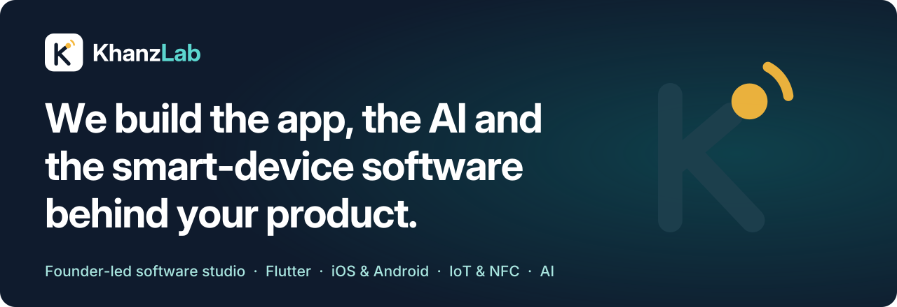
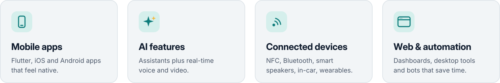
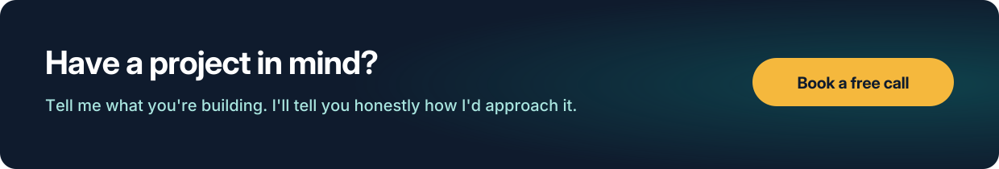

  
  &nbsp;
  
  &nbsp;
  

## Hi, I'm Abdul 👋

I'm the founder of [KhanzLab](https://khanzlab.com), a software studio that builds **mobile apps, AI features and smart-device software** for startups, growing businesses and agencies worldwide. I lead every project and write code myself, and I bring in vetted specialists when a project needs more hands.

**Stack:** Flutter · Swift · Kotlin · NFC · Bluetooth · IoT · LiveKit · AI integration · Wear OS

## What I build

## Apps live on the stores

| App | What it does | Get it |
|---|---|---|
| **TLAuth** | Reads the NFC chip in e-passports and checks the document, even offline. Built for a car-rental group's staff. | [Google Play](https://play.google.com/store/apps/details?id=com.tlapp.tl_app) · [App Store](https://apps.apple.com/ae/app/tlauth/id6776642647) |
| **TL Inspect** | Vehicle inspection app for the same fleet. | [App Store](https://apps.apple.com/us/app/tl-inspect/id6794571564) |
| **Bayaan** | Smart-home app that plays the Adhan on Google Nest and Alexa speakers. | [Google Play](https://play.google.com/store/apps/details?id=com.bayaanapp) · [App Store](https://apps.apple.com/pk/app/bayaan-app/id6748584277) |
| **Butter Skin** | AI skincare coach: skin analysis from photos, routines and an assistant. | [Google Play](https://play.google.com/store/apps/details?id=com.butter.skin) · [App Store](https://apps.apple.com/app/id6764056992) |

Most client work is private. More at [khanzlab.com/work](https://khanzlab.com/work).

 

  <a href="mailto:contact@khanzlab.com">contact@khanzlab.com</a> &nbsp;·&nbsp; <a href="https://www.linkedin.com/in/abdulmajedkhan/">LinkedIn</a> &nbsp;·&nbsp; <a href="https://clutch.co/profile/khanzlab">Clutch</a> &nbsp;·&nbsp; Based in Pakistan, working worldwide

